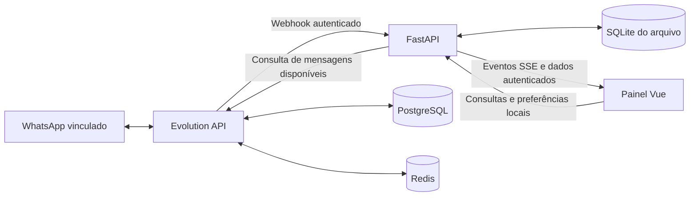

# Arquitetura

O sistema atende uma instância Evolution por processo. O backend normaliza os registros recebidos, preserva um arquivo SQLite e entrega consultas autenticadas ao painel. A Evolution API é um serviço externo, com banco e sessão próprios.

Execute um único worker/processo do arquivador por arquivo. O bloqueio da reconciliação, os limites de tentativas de login e a coordenação do cache são locais ao processo; não há coordenação distribuída para múltiplos workers ou réplicas.

## Componentes

| Local | Responsabilidade |
| --- | --- |
| `archive_service/app.py` | API, sessão, CSRF, webhook, saúde, SSE e arquivos estáticos |
| `archive_service/database.py` | SQLite, extração de conteúdo permitido, deduplicação, buscas e preferências |
| `archive_service/evolution.py` | Cliente HTTP e adaptação dos contratos Evolution |
| `archive_service/sync.py` | Reconciliação paginada, limites, checkpoint e retomada |
| `archive_service/photos.py` | Download e cache privado de fotos de perfil permitidas |
| `archive_service/users.py` | Credencial principal e diretório opcional de hashes scrypt |
| `archive_service/settings.py` | Configuração e validação de valores obrigatórios |
| `apps/panel/` | Painel Vue/Vite com interface em português |
| `deploy/docker/` | Stack genérica e inicialização da Evolution |

## Entrada e persistência

O webhook recebe somente a instância configurada e exige `X-Webhook-Secret`. Aceita envelopes de eventos Evolution e limita o corpo a 16 MiB. O arquivo não copia credenciais da integração, URLs de download ou chaves de mídia para os metadados das mensagens, nem conserva o envelope bruto. Textos e nomes preservados ainda podem conter informações sensíveis.

O banco usa a chave `(instance, chat, id)` para identificar mensagens. Registros repetidos atualizam os campos reconhecidos sem criar novas cópias. Eventos de edição e exclusão recebidos podem atualizar a linha existente; um registro marcado como excluído pode conservar texto já capturado. Isso depende do evento e do conteúdo que chegaram ao serviço, e não constitui um histórico completo de todas as versões.

O arquivo conserva identificadores de conversa, remetente/participante quando fornecidos, nome apresentado, direção, texto ou legenda, tipo, horários, origem, estado de visto local e metadados selecionados. O banco, os backups e as fotos de perfil contêm dados privados mesmo sem a mídia binária das mensagens.

O SQLite usa WAL, sincronização `FULL` e transações. No diretório de dados ficam `archive.sqlite3`, seus arquivos auxiliares quando existentes e o cache `photos/`. PostgreSQL e Redis pertencem à Evolution e não substituem o SQLite do arquivador.

## Reconciliação e cobertura

A reconciliação lê `/chat/findMessages/{instance}` em páginas. Cada página válida passa pelo mesmo escritor idempotente do webhook. O progresso fica no SQLite; ao retomar uma importação compatível, uma página já confirmada é consultada novamente para reduzir perdas na borda do checkpoint.

O tamanho da página e o limite de novas páginas por tentativa são configuráveis. A rotina detecta respostas inválidas, páginas inconsistentes ou repetidas, falhas de acesso e falta de espaço. Mantém códigos de erro e progresso, sem incluir os registros ou endereços privados nos metadados de execução.

Quando uma consulta termina, a próxima passagem começa do início. A paginação por posição não é um retrato imutável: entradas novas podem deslocar registros entre páginas. Repetição e deduplicação ajudam a recuperar registros disponíveis, mas não demonstram que o histórico do WhatsApp esteja completo. `coverage.complete` continua `false`.

O processo inicia a rotina automática após uma breve espera e repete a tentativa a cada 300 segundos por padrão. Não realiza reconexão automática nem redefine a instância. A consulta ao histórico armazenado na Evolution pode funcionar mesmo com o telefone desconectado; a atualização ao vivo depende da conexão e dos eventos.

## Atualização do painel

Alterações do arquivo geram eventos persistidos com identificador crescente. `/api/events` transmite SSE e aceita um cursor ou `Last-Event-ID`, permitindo retomar eventos disponíveis após uma interrupção. Os eventos contêm notificações resumidas; o painel consulta a API para obter os registros correspondentes.

O canal exige autenticação, envia heartbeat a cada 15 segundos e encerra uma sessão de cookie que perdeu validade. Um proxy deve permitir respostas contínuas, sem buffering ou cache do SSE.

## Acesso e estado compartilhado

O painel usa um cookie `HttpOnly`, `SameSite=strict`, com `Secure` em HTTPS. O token de sessão é armazenado no banco como hash; a sessão expira em 12 horas por padrão. Requisições de alteração com cookie exigem JSON, origem permitida quando enviada e `X-Archive-CSRF`. HTTP Basic também é aceito para clientes autenticados.

Cada sessão registra seu usuário. Entretanto, o conteúdo e as preferências pertencem à instância: marcar uma mensagem como vista, alterar uma etiqueta, favoritar ou arquivar uma conversa afeta todos os usuários deste arquivo. Não existem papéis de administrador/leitor ou escopo de dados por conta. O estado de visto local não envia confirmação de leitura ao WhatsApp.

## Fotos e mídias

Fotos de perfil são consultadas somente para conversas já presentes no arquivo. O cache aceita downloads HTTPS do host permitido `pps.whatsapp.net`, com verificação de endereço público, sem redirects, e tipos JPEG, PNG ou WebP reconhecidos. Os limites padrão são 1 MiB por download, 128 arquivos e 32 MiB no conjunto; a validade é de seis horas. URLs temporárias não são persistidas.

Os conteúdos binários das mensagens não são baixados nem conservados. Um registro de imagem, áudio, documento, vídeo ou sticker pode ter legenda, tipo e dimensões/tamanho/duração disponíveis. A lista de stickers pessoais salvos não é consultada.

## API principal

As rotas abaixo são relativas a `ARCHIVE_PUBLIC_PATH`, quando configurado. A documentação interativa OpenAPI não é publicada pelo serviço.

| Rota | Finalidade |
| --- | --- |
| `GET /healthz` | Saúde do arquivo e espaço livre; não exige login |
| `POST /api/login`, `GET /api/session`, `POST /api/logout` | Sessão do painel |
| `GET /api/status` | Conexão observada, contagens, cobertura, importação e espaço |
| `GET /api/conversations`, `GET /api/messages` | Consultas paginadas |
| `GET /api/search` | Busca global, com datas em segundos Unix, tipo, direção e conversa |
| `GET /api/conversations/labels` | Etiquetas locais disponíveis |
| `POST /api/conversations/preferences` | Favorito, etiquetas e arquivamento local |
| `POST /api/seen` | Estado de visto no arquivo |
| `GET /api/conversations/photo` | Foto de perfil autenticada, quando disponível |
| `POST /api/instance/setup` | Criar a instância ausente; preservar a existente |
| `GET /api/instance/connection`, `POST /api/instance/connect` | Consultar conexão e solicitar vínculo |
| `POST /api/history/sync` | Solicitar reconciliação; retorna `202` |
| `GET /api/events` | Canal SSE autenticado |
| `POST /webhook/evolution` | Receber eventos autenticados pelo segredo do webhook |

Não existe rota de envio de mensagens. O evento upstream `SEND_MESSAGE` identifica mensagens que outros clientes enviaram; sua captura não concede capacidade de envio ao painel.
